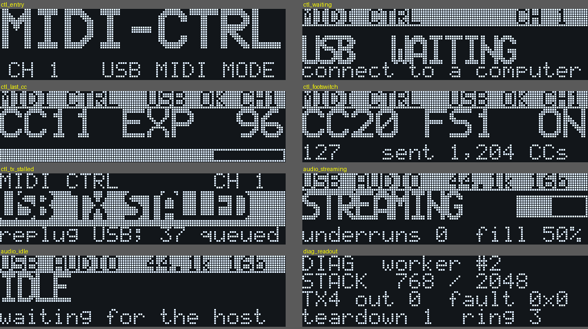

# On-device UI for USB MIDI controller mode and USB audio (2026-10-15)

Owner request: the pedal itself should show what the USB MIDI and USB audio
features are doing, with the expected visual indicators. This is the offline
design. Nothing is built into firmware yet. DO_NOT_FLASH applies.

## Current state (static analysis)

- **Neither candidate draws anything.** `firmware/controller/` and
  `firmware/usb_audio_proto/` have no display or LED calls.
- **Controller mode hides the stock screen updates.** `controller_dispatch` skips
  the MainApp handlers and *their screen actions* (recon/18 §2). After a controller-mode
  boot the LCD most likely keeps the last patch screen. Nothing shows that the
  pedal is a MIDI controller, which CC was sent, or whether USB is up. *To confirm*
  in the recon (question 4).
- The stock firmware already has a full-screen **PC MODE** bitmap (`c0178ee0`), drawn by
  `c01594c8`. It is chosen by the screen selector `c01595e8` together with two other
  full-screen renderers. The trigger condition is under recon.
- The tools available are the draw routine `c011c508` (ctx, x, y, w, h, bitmap), seven firmware fonts
  (recon/10) and string routines near `c011ebc8`/`c011ec48`.

## What the screens should show

Mock-ups drawn with the pedal's own fonts by `tools/ui_mock.py`:

| State | Screen | Indicator purpose |
|---|---|---|
| Controller-mode entry (boot with Rhythm held) | `ctl_entry`: big MIDI-CTRL, then the channel | Confirms that the mode gesture worked; stock UI is off |
| Controller mode, USB not configured | `ctl_waiting` | Shows why no CCs reach the computer |
| Knob or expression moved | `ctl_last_cc`: CC number, source name, value and a 0..127 bar | Live feedback; mapping check (the physical legends are unverified, recon/17 A5) |
| Footswitch or button | `ctl_footswitch`: CC, source, ON/OFF, value and sent count | Confirms the press and the polarity |
| TX stalled (the liveness risk in `SOL_EXPIRY_RECOVERY_REPORT.md`) | `ctl_tx_stalled`, inverted | The one failure you cannot otherwise see; tells you to replug |
| USB audio streaming | `audio_streaming`: rate/format, ring fill bar, underruns | Confirms the stream and clock-drift health |
| USB audio alt 0 | `audio_idle` | The host has not opened the input |
| Diag build | `diag_readout`: stack peak, worker instance, TX4 outstanding, faults | **Works even when USB TX is stalled**, the case where the MIDI readback cannot report |

Rules:
- Small text uses `font_5x7` (6 px cells, 21 per line, 4 lines). Values use
  `font_11x13`/`font_8x13`. The big fonts have no space or punctuation.
  `ui_mock.overflows()` must stay empty.
- Rate-limit redraws to about 20 Hz and coalesce to the newest value. Never draw per CC.
- No drawing from Hwi or Swi context (the SOF tick, the tap) or under MIDI_LOCK. Those
  contexts only publish counters, and a drawing context renders them.

## Recon results (Sol report + Claude review, `docs/helpers/ONDEVICE_UI_RECON_REPORT.md`)

- PC MODE means the editor session flag `B14[27]`, not USB enumeration. It cannot serve as a
  USB indicator.
- UpdateUI owns drawing. Buffers are `11800000 + ctx*0x200` with dirty-page bits at `11813250+ctx`.
  The flush is `c014db8c` (the `B14[149]` lock, then `c016f420`). The glyph and bitmap primitives
  are **not** self-locking.
- Text: `c011e000(ctx, str, x, y)` draws 5x7 text; `c011ec48`/`c011ebc8` draw 8x13 text
  (left-aligned / centred); `c016c360` is sprintf-like.
- **No firmware-driven LEDs (likely).** The LCD is the only indicator.
- Design: producers (MainApp, AD, the MIDI worker, the USB lifecycle, the SOF counter) only store
  packed words. One UpdateUI-side wrapper draws and flushes when they change. Hook site:
  `c013c4e8 CALLP c0156e80` (32-bit). Sol's `c013c74e` is a compact CALLP and cannot be
  retargeted. Gate before building: trace the screen switch at `c013c4ec..`.

## Original open questions (recon brief `docs/helpers/ONDEVICE_UI_RECON_BRIEF.md`)

1. Which task owns the framebuffer and the flush, and whether other tasks may draw.
2. The cheapest hook: reuse the stock PC MODE screen path with a custom renderer,
   or a periodic redraw from housekeeping `c01537f4`.
3. LEDs: whether the firmware drives any.
4. Screen ownership after controller mode exits, which happens only at the next boot
   in v1.

## Order

1. Recon: done (see above). Next, trace the `c013c4ec..` screen switch, then build.
2. Diag build first: the `diag_readout` screen. It adds value immediately for the first
   hardware run, because it reports even when MIDI TX is stalled.
3. Controller screens, then audio screens, each as a separately hash-pinned candidate.
   None reaches the pedal without the owner's go-ahead.
